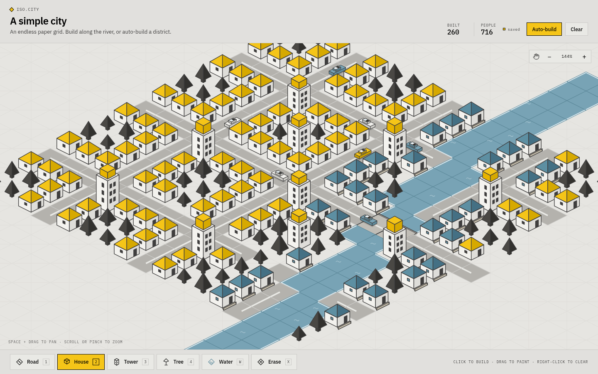

# iso.city

A tiny endless isometric city builder for the browser. Build by hand along the
river, or press **Auto-build** to fill a rule-generated district. Roads and
rivers connect on their own, houses near the water become lakehouses, and little
cars drive through the streets. Every change is saved to `localStorage`, and the
static build deploys to GitHub Pages with no backend.

**Live:** <https://radmerales.github.io/isometric/>



## Features

- Endless isometric grid with pan, zoom, and a seeded winding river
- Rule-based **Auto-build**: a 17 × 17 district anchored to a 5-tile street grid
  - Empty street-line tiles become roads
  - Street-facing plots become houses, with a tower at one corner of each block
  - Courtyard plots become trees
  - Water and existing structures are never overwritten
- **Lakehouses** anywhere within two tiles of water get a blue roof, a deck, and
  blue window glass
- **Moving cars** follow the road network, turn at intersections, and scale with
  the size of the city
- Roads auto-connect; roads laid over water become bridges
- Roads, houses, towers, trees, water, and erase tools
- Live built/population counts and browser autosave
- Paper/ink visual language with a single yellow accent

## Stack

- **Vite + TypeScript** for the dev server and static production build
- **Hand-written CSS** in the paper/ink visual language
- **Inline SVG** for the infinite grid, river, bridges, buildings, and cars
- **`localStorage`** for persistence

## Run

```bash
npm install
npm run dev
```

Open <http://localhost:5173>.

```bash
npm run build    # typecheck + build to dist/
npm run preview  # preview the production build
```

## Controls

| Input | Action |
| --- | --- |
| Click / tap | Build with the selected tool |
| Drag | Paint across tiles |
| Right-click | Clear a tile |
| `1` `2` `3` `4` | Road, House, Tower, Tree |
| `W` | Water |
| `X` or `E` | Erase |
| `G` | Auto-build the district around the view centre |
| `H` | Toggle the pan tool |
| Space + drag / middle-drag | Pan |
| Wheel / pinch / `+` `-` | Zoom |
| `0` | Reset the view |

The **Clear** button removes buildings, roads, and trees but keeps the river.
The eraser removes structures first, then water. Cars are decorative and respawn
on reload.

## Deploy

The workflow at `.github/workflows/deploy-pages.yml` builds and deploys the site
on every push to `main`. In the repository settings, set **Pages → Source** to
**GitHub Actions**.

The Vite config uses `base: "./"` and the build includes `.nojekyll`, so the same
`dist/` works at a custom domain root or under `/<repository>/` on GitHub Pages.
